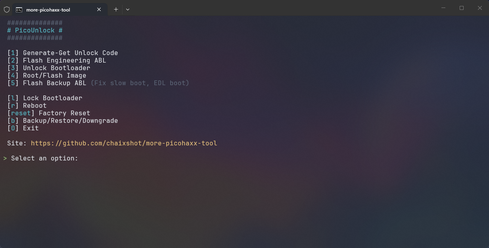
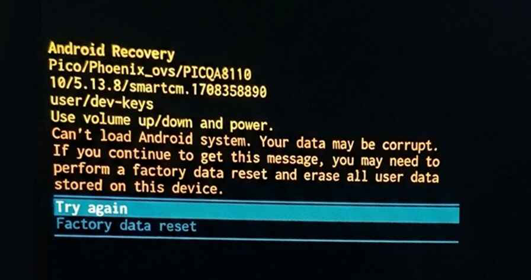

# Pico 3/4 Bootloader Unlock & Root Tool & Data Backup & Downgrade

 

This tool contains a comprehensive set automation scripts for unlock Bootloader, rooting, full backup, and Rollback OS the **Pico 4**, **Pico 4 Pro**, **Pico 4 Enterprise**, and **Pico Neo 3** VR headsets.

### [Download Tool](https://github.com/chaixshot/more-picohaxx-tool/releases/latest/download/more-picohaxx-tool.zip) and run `picounlock.bat` to begin

> [!IMPORTANT]
>To update the new version, please move `./backup` and `./logs` from the previous tool folder.

> [!CAUTION]
> Bootloader state changes (LOCK ↔ UNBLOCK) will **WIPE ALL USER DATA** (Factory Reset). 
> Previous **User Personal Data** backup partition will not work after the state changes due to the internal decryption key being permanently reset. 
> Perform app data backups using an external application before proceeding. 
> 

## Status

* **Pico 4**: Confirmed working (v5.13.8 and below).
* **Pico 4 Pro**: Confirmed working (v5.13.8 and below).
* **Pico Neo 3**: Confirmed working (v5.11.2 and below).

## Prerequisites

* **Windows PC**: The automation script is written in [PowerShell](https://github.com/powershell/powershell).
* **PowerShell Execution**: If script can not run, follow [ps-enabling-exec-scripts](https://github.com/whonion/ps-enabling-exec-scripts) guide
* **Pico Headset**: Pico 4, Pico 4 Pro, or Pico Neo 3 with [USB Debug](#usb-debug) enabled.

## Backup

This tool includes a built-in **Backup** suite to protect user data from **Factory Reset** and **Headset Bricking**.

> [!NOTE]
> Uses the folder `./backup` to store data by default.

### Backup Modes

* **Physical Binary Dump (LUNs)**
  * Sector-by-sector clone of physical drives (`LUN 0-6`).
  * Best for unbricking, GPT repair, and low-level recovery.
  * Excludes partition of `userdata`.
* **Full User Personal Data (UserData)**
  * Backup of the full partition `userdata` only.
  * Includes all apps, games, photos, and internal storage files.
  * Size depends on device model (e.g., `128/256/512 GB`).
* **Usage Of User Personal Data (Used UserData)**
  * Backup of the usage of `userdata` sector only.
  * Includes all apps, games, photos, and internal storage files.
  * Size depends on the usage of the device data. Good for a `256/512 GB` device.
  > This is experimental to reduce the backup disk space. It might be unreliable.
* **System Partition Dump (Partitions)**
  * Individual file per system partition (`boot`, `abl`, `system`, etc.).
  * Best for general firmware backup or modding. Excludes `userdata`.
  * Balanced safety and manageable size (`~10-15 GB`).

### Backup Features

* **Custom Backup Folder**: Specify folder path when starting a backup to save space on system drive or organize files manually.
* **LZX Compression**: Optional folder compression for backups using Windows native `compact.exe`. Reduces backup size by up to **60%** while keeping files directly accessible with negligible CPU impact.
* **EDL Integration**: Automates the complex **EDL** workflow using the provided `QFILHelper`.

## Restore

* **Backup Selector**: Select between different backup sets using the menu.
* **Custom Restore Folder**: Paste a backup folder path directly into the menu. Automatically detects the backup type (`LUNs`, `UserData`, `Partitions`, or `Downgrade`) based on the files inside.

> [!NOTE]
> Scan default folder `./backup` to create menu.

## Unlock Bootloader

1. **Backup**: Perform app data backup using an external application.
1. **Get Unlock Code**: Acquire headset `serial_number` (Chip ID) via `adb` (from `/sys/devices/soc0/serial_number`) to generate `fastboot oem picoXXXXXXXX unlock` command.
1. **Flash Engineering ABL**: Flash the old `abl` and `devinfo` to enable bootloader token.
1. **Unlock Bootloader**: Issue the generated command from **Get Unlock Code**, followed by:
    * `fastboot flashing unlock_critical`
    * `fastboot flashing unlock`
    * `fastboot oem setenforce 0`
1. **Verify Bootloader**: Reboot bootloader to confirm unlock state is persistence.
   * If it isn't stay unlocked, **repeat the steps**. This is expected behavior; don't be afraid to try again.
1. **Flash Backup ABL**: Flash original firmware `abl` image to restore boot capability.
1. **Factory Reset**: Perform factory reset via recovery to wipe user data.
1. **Root with Magisk**: Flash Magisk patched `boot.img` to get superuser access.
1. **Restore Userdata**: Restore backed-up user data

## Root with Magisk

The tool includes an automated workflow to **Root** and **SELinux Permissive** the headset directly from Windows:

1. **Pull Boot Image**: Pull firmware `boot.img` directly from headset via EDL mode.
1. **Install Magisk**: Installs `Magisk4Pico.apk` directly to headset.
1. **Native Windows Patching**: Automatically patches `boot.img` on Windows using the integrated **MagiskBoot** tool without needing manual patching on the headset.
1. **Flash Patched Image**: Flashes `magisk_patched.img` via EDL mode.
1. **Verify Root**: Checks and confirms superuser access via `adb` command.

### Root Tweak

Recommend [Magisk](https://github.com/topjohnwu/magisk) modules and [Xposed Framework](https://github.com/JingMatrix/Vector) apps

#### Core Framework

* [NyaZygisk](https://github.com/HSSkyBoy/NyaZygisk) - Zygote injection with ptrace
* [Vector](https://github.com/JingMatrix/Vector) - Zygisk module providing an ART hooking framework that maintains API consistency with the original Xposed.

#### Magisk Modules

* [Pico-Screenshot-Hires](https://github.com/hhhbwc/pico-screenshot-hires) - Unlock system screenshot resolution.
* [Pico4-Aggressive-Fan](https://github.com/hhhbwc/pico4-aggressive-fan) - Fan temp control, bypass stock 35% duty lock, one tier higher, vendor service untouched.
* [PicoXPad](https://github.com/d4nielrx/PicoXPad) - Turn your Pico controllers into a system-wide Xbox gamepad.
* [Pico4-TrackerLimit](https://github.com/hhhbwc/pico4-trackerlimit) - Motion Tracker full unlock. 2/3/5 point mode switching.

#### Xposed Modules

* [PicoDockShortcut](https://github.com/chaixshot/PicoDockShortcut) - Manage dock pinned shortcuts.
* [Pico3dResolution](https://github.com/chaixshot/Pico3dResolution) - Change 3D resolution and power level.
* [PicoNeverSleep](https://github.com/chaixshot/PicoNeverSleep) - Add the never-sleep shortcut to quick-setting panel to allow the headset to stay awake.
* [PicoWindowResize](https://github.com/autodistries/PicoWindowResize) - Resize opened windows
* [PicoLibraryCategories](https://github.com/autodistries/PicoLibraryCategories) - Lets you control categories and sort your apps through the native app launcher.
* [Pico-4-IME-Unlock](https://github.com/Skyrimus/Pico-4-IME-Unlock) - Use other installed keyboard as default keyboard.
* [PicoFanControl](https://github.com/Seva167/PicoFanControl) - App to override fan speed with root
* [Pico-ResFix](https://github.com/hhhbwc/pico-resfix) - Unlocking per-app resolution for 2D applications.
* [Pico4-WinLimit](https://github.com/hhhbwc/pico4-winlimit) - 2D floating window limit unlock LSPosed module.
* [Pico-Custom-Wallpaper](https://github.com/hhhbwc/PICO-Custom-Wallpaper) - Provides independent static wallpapers and crop previews.
* [Pico4-Sleep-Mode](https://github.com/hhhbwc/pico4-sleep-mode) - Quick-setting toggle that enables a low-power VR sleep mode.
* [Pico4-Quest3-Swap](https://github.com/hhhbwc/pico4-quest3-swap) - Swap the quick-setting panel device art (headset + controllers) for official Meta Quest 3.
* [Pico-Unknown-Source-Remover](https://github.com/hhhbwc/pico-unknown-source-remover) - Hide AppManager's Unknown section and show SDK apps under Apps.
* [Pico4-Power-Mode](https://github.com/hhhbwc/pico4-power-mode) - Unlocks the hidden "High Performance" power mode in settings.
* [Pico4-FW-Anchor](https://github.com/hhhbwc/pico4-fw-anchor) - Spatial window anchoring, keep 2D far windows where you put them.

#### Other

* [PICO-4-GPU-Overclocking](https://github.com/hhhbwc/PICO-4-GPU-Overclocking) - GPU overclock.
* [Pico4_120HZ](https://github.com/hhhbwc/pico4_120hz)  - Unlocking display refresh rate 120Hz.

## Flash Custom Image

When the bootloader is unlocked, the device can flash a custom image via EDL mode. This will help with stable development from Engineering ABL unstable boot.

## Rollback OS

Full firmware downgrades and dynamic partition processing, allowing the device to roll back to any firmware version.

* **Downgrade**: Introduction to using the legacy downgrade 5.6.0 partition file set.
* **Firmware Downloader:** Built-in menu to get firmware version download links.
* **Archive Extraction:** Automatically extracts compressed firmware packages (`.zip`, `.rar`, `.7z`).
* **Automated EDL Flashing:** Safely transitions the device into EDL mode and flashes system and firmware images sequentially.

> [!WARNING]
> Downgrading OS versions introduces encryption (`keystore`) and SELinux mismatch risks. 
> Depending on the target version, a factory reset may be required to prevent non-bootable states or bootloops. 
> Always perform a **User Personal Data** backup before proceed.

## Troubleshooting & Tips

### Unlock Persistence

If `fastboot oem device-info` shows the headset as locked after the first attempt, **repeat the unlock commands**. It is known that the unlock bits (written to protected RPMB storage) might not "stick" immediately.

### Slow Boot or EDL Boot

Using the **Engineering ABL** can cause issues like slower boot or unexpectedly entering EDL mode. To fix this:

1. Use the **"Flash backup ABL"** option in the script menu. This restores firmware `abl` partition.
2. Because the unlock state is stored in the **RPMB**, headset will remain unlocked even with the firmware ABL.

### USB Connectivity

* Use a high-quality USB-C cable.
* If EDL mode is unstable, try a USB 2.0 port.

### USB Debug

1. Enter **Pico OS** settings menu
1. Go to **General** > **About**
1. Tap **Software version** 7 times quickly until the **Developer** tab appears
1. Go to **Developer** tab and enable the **USB Debug** option

### Manual Boot

* [Recovery mode](https://wikipedia.org/wiki/Android_recovery_mode) - Dead robot
* [Fastboot mode](https://wikipedia.org/wiki/Fastboot) - Left eye menu
* [EDL mode](https://wikipedia.org/wiki/Qualcomm_EDL_mode) - Black screen

#### Pico 4

* **System**: Hold <kbd>Power</kbd> until Pico logo shows up.
* **Recovery**: Hold <kbd>Vol Up</kbd> + <kbd>Power</kbd> until dead robot shows up.
* **Fastboot**: Hold <kbd>Vol Down</kbd> + <kbd>Power</kbd> until menu shows up.
* **EDL**: Hold <kbd>Vol Up</kbd> + <kbd>Vol Down</kbd> + <kbd>Power</kbd>.

#### Pico Neo 3

* **System**: Same as Pico 4.
* **Recovery**: Hold <kbd>Vol Up</kbd> + <kbd>Power</kbd> + <kbd>Home</kbd> until dead robot shows up.
* **Fastboot**: Hold <kbd>Vol Down</kbd> + <kbd>Power</kbd> + <kbd>Home</kbd> until menu shows up.
* **EDL**: Boot to **Fastboot** and using the tool reboot menu to enter **EDL**.

> [!NOTE]
> **Pico Neo 3**:
>
> * **Home** button is the button that has Pico logo
> * Newer firmware than **5.9.9**, enter **EDL** with key combination and command will no longer work.

> [!TIP]
>
> * Manual EDL mode:
>   * Key Combination:
>     1. Unplug the USB from the device that is still connected to the PC.
>     1. Power off the device via the power button or the Bootloader menu.
>     1. Holding <kbd>Vol Up</kbd> + <kbd>Vol Down</kbd>.
>     1. Plug the USB into the device while still holding the buttons.
>   * Use **EDL 9008 Cable**, confirmed works to enter EDL from the power off state.
>     * [Make it yourself](https://xdaforums.com/t/edl-cable-for-nothing-phone-2.4654742/) or buy one.
>   * [EDL test points jumper](https://github.com/chaixshot/more-picohaxx-tool/issues/5#issuecomment-5967802023)

### Recovery Mode

1. Robot shows up with `"No command."` message as recovery mode.
1. In recovery mode, hold <kbd>Power</kbd> first then press <kbd>Vol Up</kbd> to access the menu.
1. Use <kbd>Vol Up</kbd> and <kbd>Vol Down</kbd> to navigate, and press <kbd>Power</kbd> to select.

### Undo

This tool includes **Unroot** and **Lock Bootloader** options.

## Key Components

* `more-picohaxx.py`: The core logic for deriving the unlock code from the headset serial number.
* `picounlock.bat`: A convenient wrapper to run the script with Administrator privileges.
* `picounlock.ps1`: The main automation `PowerShell` script.
* `modules/`: Contains modularized logic for `picounlock.ps1`.
* `tools/`: Android platform tools, and `edl-ng`.
* `tools/driver`: Qualcomm usb driver.
* `tools/engineering`: Engineering ABL & Devinfo.
* `tools/firehoses`: EDL firehose flashing protocol .
* `tools/magisk`: Rooting the headset after unlocking.
* `tools/rollback`: Tools to make flashable partitions from **firmware.zip**.
* `logs`: Everything that is written on the console.
* `backup`: Default headset backup which is `abl`, `partitions`, and `boot.img`.

## Credits

* **[typlo](https://github.com/264312431)**: Discovery of the bootloader bypass method and original root exploit.
* **[Fallen Angel](https://github.com/FallenAngel-PP)**: Fearless testing, validation, and development of Magisk4Pico.
* **[QFILHelper](https://github.com/Beliathal/QFILHelper)**: Guideline flashing manager.
* **[edl-ng](https://github.com/strongtz/edl-ng)**: Modern Qualcomm Emergency Download (EDL) CLI tool.
* **[magiskboot](https://github.com/Pranav-Talmale/magiskboot)**: Windows port of Magisk's boot image patching utility.
* **[7zip](https://github.com/ip7z/7zip)**: Archive extraction utility.
* **[brotli](https://github.com/google/brotli)**: Brotli compression and decompression binaries.
* **[aosp15_partition_tools](https://github.com/Rprop/aosp15_partition_tools)**: Tools for building and manipulating `super.img` dynamic partitions.

---
*For more technical details on the bypass mechanism, refer to the comments in `more-picohaxx.py`.*
